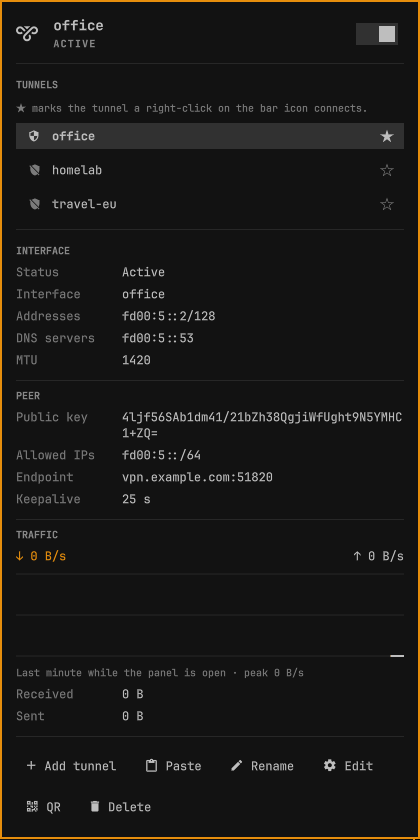
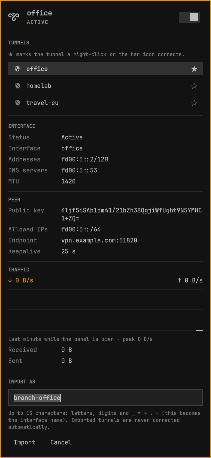
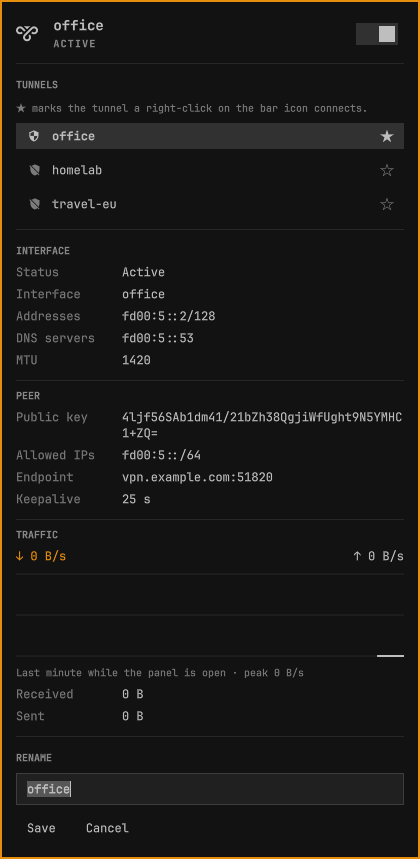
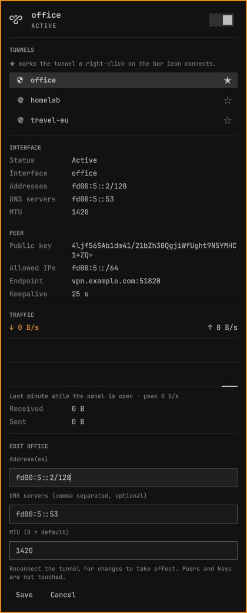
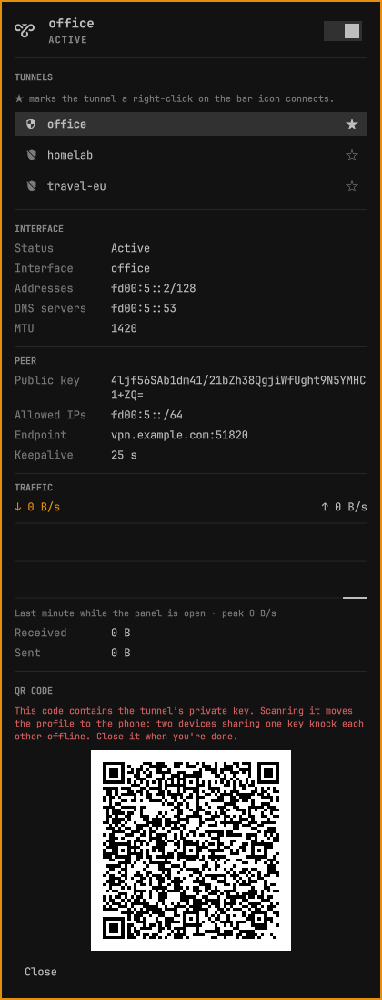
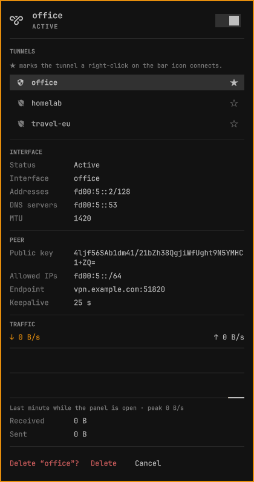

# Wirebar

WireGuard tunnels in the [Omarchy](https://omarchy.org) bar. Connect, switch,
import, rename, edit and QR-export tunnels, with live traffic and ping, all
from a bar icon. No root, no sudo, no `wg-quick`.

Wirebar is an unofficial community plugin. It is not affiliated with,
endorsed by, or connected to the WireGuard project or Omarchy.



*The screenshot uses made-up tunnels and reserved example addresses.*

## How it works

Tunnels are NetworkManager connection profiles. Wirebar lists every WireGuard
profile NetworkManager knows about and drives them with `nmcli`, which talks to
NetworkManager over D-Bus and is authorised by polkit. Because nothing runs as
root, there are no sudoers rules and no password prompts.

NetworkManager never runs `PreUp`/`PostUp`/`PreDown`/`PostDown` hooks, so a
config file is data, not code. Configs that use hooks (or `Table`/`SaveConfig`)
are refused on import instead of being half-imported.

## Requirements

- Omarchy with the Quickshell shell (`omarchy-shell`)
- NetworkManager, with the tunnels managed by it
- Optional: `qrencode` (QR export), `wl-clipboard` (paste/copy)

`wireguard-tools` is not needed. Tunnels run by `wg-quick` or its systemd
units are invisible to Wirebar, which only sees NetworkManager connections.

## Install

```bash
omarchy plugin add https://github.com/TomZandt/omarchy-wirebar.git --enable
```

Plugins are added disabled so you can read the code first. Drop `--enable` to
review it before switching it on, then:

```bash
omarchy plugin enable tzv.wirebar right
```

Remove it with `omarchy plugin remove tzv.wirebar`. Your WireGuard connections
belong to NetworkManager and are not touched.

## Using it

| Click on the bar icon | Does |
| --- | --- |
| Left | Opens the panel |
| Right | Connects your favorite (or last-used) tunnel, or disconnects the live one |
| Middle | Refreshes |

The icon is bright while a tunnel is up and dimmed when none is.

**Favorite.** Click the star on a tunnel row to make it the right-click
target. The first tunnel you add becomes the favorite, and adding a second one
keeps a lone tunnel pinned, so right-click never quietly changes meaning. With
no favorite set, right-click uses the most recently used tunnel.

**Panel.**

- Header switch connects or disconnects the selected tunnel. Connecting is
  exclusive: the new tunnel comes up first, and only once it is up do the other
  WireGuard tunnels go down. A profile that fails to connect therefore leaves
  your current tunnel untouched. There is no automatic rollback: if dropping an
  old tunnel fails you get an error and both stay up.
- Connected tunnels sort to the top.
- Interface and peer details. Click a value to copy it.
- While connected: live download/upload rates, a one-minute graph and byte
  totals. Traffic is sampled whenever a tunnel is up, so the graph already has
  history when you open the panel. Ping through the tunnel (to the tunnel's DNS
  server, or a host inside its first AllowedIPs; set `pingHost` to override) runs
  only while the panel is open, since it is the one probe that sends packets.
- **Add tunnel** imports a `.conf` file; **Paste** imports one from the
  clipboard. You choose the name, because it becomes the interface name (up to
  15 characters of `A-Z a-z 0-9 _ = + . -`). NetworkManager itself briefly
  activates a tunnel at import time, so Wirebar turns autoconnect off and
  disconnects it straight away; if that step fails you are told. An existing
  connection with the same name, of any type, is never touched.
- **Rename**, **Edit** (address, DNS, MTU) and **Delete** (asks first).
- **QR** shows the profile as a QR code for the WireGuard phone app. The code
  contains the private key, so it only appears when asked for, and the image is
  deleted when you close it. Scanning moves the profile; two devices sharing one
  key knock each other offline.
- A notification appears when a tunnel drops outside Wirebar.

Keys in the panel: `↑`/`↓` select, `t` toggle, `a` add, `v` paste, `n` rename,
`e` edit, `q` QR, `r` refresh, `Delete` delete, `Esc` close.

## The forms

Import, rename, edit, QR and delete open inline in the panel. These screenshots
use made-up tunnels, reserved example addresses and throwaway keys.

| Import | Rename | Edit |
| --- | --- | --- |
|  |  |  |

| QR code | Delete |
| --- | --- |
|  |  |

## Settings

Set with `omarchy bar set tzv.wirebar <key> <value>` or in `shell.json`.

| Key | Default | Meaning |
| --- | --- | --- |
| `connection` | empty | Favorite tunnel (the star writes this) |
| `refreshIntervalSec` | 10 | How often the tunnel list refreshes |
| `pingHost` | empty | Address pinged through the tunnel; empty picks one automatically |

## Command line

`omarchy-shell wirebar form <name|rename|edit|qr|delete>` opens the panel on one
of its forms, which is handy for keybindings. `omarchy-shell shell summon
tzv.wirebar` and `hide` open and close the panel.

## What it runs and writes

Wirebar has no background service and needs no privileges. Everything runs as
your user.

- **Runs:** `nmcli` for every tunnel action; `ping`, bound to the tunnel
  interface, to the tunnel's DNS server or a host inside its AllowedIPs (or your
  `pingHost`), only while the panel is open; `wl-copy` and `wl-paste` to copy a
  value or import from the clipboard; `qrencode` for QR export, on request;
  `omarchy-file-select` for the file chooser; `omarchy-notification-send` for
  drop notifications; and `omarchy bar set` to save the favorite. It also reads
  `/sys/class/net/<interface>/statistics/` for traffic.
- **Changes NetworkManager only when you ask:** connect, disconnect, import,
  rename, edit and delete, and only on WireGuard profiles you select. An import
  refuses a name that any existing connection already uses.
- **Writes one setting of its own:** `connection` (the favorite) on its own
  entry in `~/.config/omarchy/shell.json`, through `omarchy bar set`. That
  happens when you click a star, and automatically in two cases: the first
  tunnel you import becomes the favorite, and importing a second tunnel pins
  the lone one you already had. Nothing else in your configuration is touched.
- **Temporary files:** a private (mode 700) folder under `$XDG_RUNTIME_DIR`
  holding drop-notification records and the QR image while it is shown, plus
  short-lived mode 600 files for a clipboard import. The QR image and clipboard
  files are deleted as soon as you are done with them; the few small
  drop-notification records are cleared when the folder disappears at logout.
  Nothing is written to `/tmp`.
- **Network:** no traffic of its own apart from that ping.

Removing it with `omarchy plugin remove tzv.wirebar` deletes the plugin and its
bar entry. Your WireGuard connections stay in NetworkManager.

## Limits

- **No last-handshake time.** NetworkManager does not report it; `wg show`
  needs root. Health is shown as live traffic and ping instead.
- **Early release.** Switching, import, rename, edit, QR and delete have been
  exercised through the backend script against throwaway tunnels. The panel's
  click-through paths are newer, so expect rough edges and please open an issue.
- NetworkManager only. No `wg-quick` or `systemd-networkd` support.

## Credits and licence

MIT, see [LICENSE](LICENSE). The feature set was shaped by studying several
MIT-licensed Omarchy WireGuard widgets; the code here is a fresh
implementation. See [CREDITS.md](CREDITS.md).
